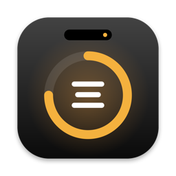

<h1 align="center">Focus Island</h1>

Your MacBook notch, now useful.

<a href="https://github.com/Omar01-E/focus-island-download/releases/latest/download/Focus-Island-1.0.dmg"><b>⬇︎ Download Focus Island for Mac</b></a>

Now Playing with controls, a focus timer with background sounds, widgets (calendar, weather,
world clock), a file shelf with AirDrop, system stats, a sleek volume & brightness display,
live call activity, and three looks: Classic, iOS and Liquid Glass.

## Install
1. Download the `.dmg` above and open it.
2. Drag **Focus Island** into **Applications**, then open it.
3. The first time, macOS says it can't verify the app (it's a test build, not yet notarized by Apple).
   Click **Done**, then go to **System Settings → Privacy & Security** and click **Open Anyway**.
   You only do this once.
4. Move your mouse to the notch at the top of the screen.

**Requires** macOS 14 or later · Apple silicon or Intel.

**Feedback:** in the island, **⋯ → Send Feedback…**

---
© 2026 Omar El Akrae. All rights reserved. This page hosts the app only; the source code is private.
Free to download and use; you may not copy, modify, redistribute or sell it.
